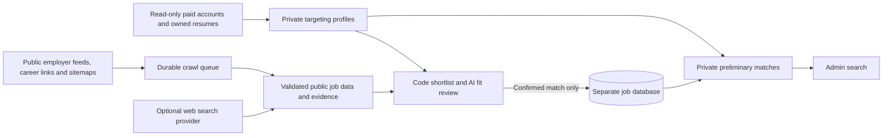

# Paid-user job index

The collector is independent of application runs. It reads active paid accounts, derives role/skill targeting from saved keywords and owned resumes, gathers public vacancies, shortlists by current preferences, reviews professional fit with MiniMax, and stores only confirmed matches in a **separate Neon-hosted PostgreSQL database, outside the VPS**. The crawler process can run on the VPS; the job catalog is never provisioned there. The administrator can search it under the admin-only **Jobs** sidebar tab. No job is approved, prepared, submitted or charged an application credit by this collector. Existing application schedules and fit criteria are unchanged.

## Manual search controls

In Admin → Jobs, choose **Search with Brave** or **Search with Codex**. There are no automatically scheduled searches. Both choices create an administrator-attributed request in Neon; one active request across providers prevents duplicate spending. Progress, completion, new-job count and failures are visible on the same page. Pause prevents starts and further catalog writes. Expired leases can be failed explicitly when the next admin starts a request; old outcomes are preserved.

Brave uses the server connection and the existing daily provider/model limits. Codex uses a local, signed-in Codex CLI connector installed with `deploy/install-job-index-codex-connector.ps1`. Its per-user Windows startup entry starts the connector only; it never starts a search. The computer must remain awake, signed in and connected. The UI disables Codex when its SSH heartbeat is offline. Authentication stays on the computer and is never copied to the VPS. The connector sends only derived search preferences, not CVs, names or candidate answers. Each admin request launches an ephemeral read-only Codex session with live web search and command execution disabled, an empty temporary workspace, structured output, a nine-minute limit and no fixed listing-count cap. The structured output and importer accept more than 15 results, bounded by a 2 MB transfer-size safeguard rather than a vacancy count. A shared deployment lock protects each active import.

Codex explicitly searches Jora Australia, Adzuna Australia and other public aggregators (including Careerjet, Jooble, Talent.com and Jobrapido) alongside employer career pages. It follows public outbound links to the same employer/ATS vacancy, excludes aggregator-hosted application routes, deduplicates by the final employer URL and retains the discovery-source URL as evidence. Access refusals, logins and CAPTCHAs are not bypassed.

Codex suggestions must be independently fetched under the existing robots/SSRF/access rules, bound to the original page, and supported by exact title, company, description and location quotes. Structured publisher data takes precedence, including foreign country restrictions. Pages without JSON-LD may use verified visible role content; footer/headquarters statements alone do not establish job location. Exact Australian capital/subdivision pairs such as Sydney, NSW resolve to Australia; a bare city remains unknown. MiniMax still performs the independent owner-specific fit review, and only current paid owners with approved Australian matches can retain catalog jobs. Token usage from Codex is recorded without inventing a dollar charge.

## Collection and coverage

Built-in feed parsers cover Greenhouse, SmartRecruiters, PageUp and Workday, using their public job data. Existing paid-user employer selections and employer URLs are starting points. Career links and XML sitemaps expand discovery; observed ATS URLs can add new employers to the feed queue. Generic career pages use bounded JSON-LD `JobPosting` graph extraction. A page without readable public job data is not converted into a guessed vacancy.

Publisher extraction also reads scoped schema.org JobPosting microdata, including SuccessFactors job pages. Nested employer headquarters cannot supply a vacancy's country, and existing JSON-LD takes precedence. Lever vacancy pages are verified against the same posting's public Lever API record; the API supplies role-specific country, arrangement, duties and creation date, while the employer name and title must bind to the publisher HTML. Both search providers use these extractors without changing saved fit criteria or admitting unreviewed jobs.

Brave Search provides optional broader web leads; it requires a separately configured key, and this feature does not buy a subscription. Search combines derived resume skills and current role keywords, interleaving paid owners and rotating ATS-specific searches daily. Raw resumes, names, contact information and candidate answers never go to the search provider. There is a durable global cap of **20 search requests per database day**. Search responses, including returned URLs and snippets, stay in memory and are not added to the durable queue. The collector fetches publisher pages immediately and persists only publisher-observed links and job facts with an independently declared job/canonical URL. This is bounded discovery across public sources, not a claim to cover every job on the internet. Unsupported JavaScript layouts or denied sources remain coverage gaps until an adapter is added; collection does not bypass login or challenges.

## Tags and matching

Stored fields include employer, title, canonical source URL, source identity, full available description, location, applicant-location restrictions, remote/hybrid/onsite/unknown arrangement, salary disclosed/unpaid/not mentioned, structured salary range/currency/period when supplied, employment type, occupation category, seniority, skills, suitability audiences, stated qualifications/experience/eligibility requirements, posting/closing dates, first seen and last verification.

Evidence accompanies tags; inferred occupation categories are marked inferred. Missing pay is not called unpaid. A postal location alone does not prove onsite work, and remote work does not prove eligibility from any country. An Australia-only admission policy runs before any AI call and again at final review and storage. Explicit publisher country codes/names or country-labelled job locations are required; remote roles must permit Australian residence, and foreign-only applicant restrictions veto an Australian office address. Bare cities without a validated subdivision, APAC, worldwide/remote labels, employer headquarters, currency and incidental description mentions do not establish eligibility. Unknown geography is counted separately and excluded pending better publisher evidence. The same policy validates existing catalog records during migration: non-Australian/unknown jobs and their versions/matches are removed; verified Australian records are retained. Reads quarantine unvalidated country-policy records. Brave queries require Australia and use Australian results, but publisher facts decide admission. Country facts remain distinct from display labels, including Workday detail country data. Code shortlists current keywords or multiple shared skills so equivalent titles reach review. MiniMax M3.1 Flash then enforces current occupation instructions, minimum score, arrangements, city/radius, salary, job types, listing age and mandatory requirements against professional resume evidence. A match needs exact employer and candidate evidence. Fabricated quotes, malformed/truncated output, low scores, uncertainty and errors cannot admit jobs. These are **reviewed discovery matches**, never approval to prepare or submit an application. Private profiles retain derived terms, numeric preferences and fingerprints, not raw resume text or standing instructions. Resume evidence and instructions stay in bounded process memory. Email, phone and URL contact details are removed before AI review; identity is not a fit criterion. Unchanged resumes are cached; changed files/settings invalidate targeting and remove stale matches. Deleted, blocked or expired-paid owners and their private matches are purged on the next worker check, including while collection is paused. Catalog jobs and versions are removed when no current approved owner remains. The release migration removes the previous unreviewed catalog only; it never touches application history or customer settings.

## Persistence and operational boundaries

Jobs deduplicate by canonical URL, stripping tracking parameters while preserving vacancy identifiers. Distinct URLs are not guessed to be identical merely from an employer/title. A per-vacancy transaction lock protects simultaneous writes; content versions preserve prior public facts. Jobs disappear from current search when closed, expired or not verified for 14 days. Confirmed HTTP 404/410 and expired structured listings close existing entries; inaccessible pages are not falsely called closed.

The queue uses leased tasks, `FOR UPDATE SKIP LOCKED`, a single-worker advisory lock, owner-scoped matching, stale-lease protection and bounded retries (three failed task attempts). Pages, search and each feed source receive rotating turns; detail tasks take priority within a lane so blocked feeds cannot monopolize discovery. Interrupted cycles remain recorded. Requests are DNS-pinned to validated public IPv4 addresses, with every redirect checked, byte/time limits, robots rules, host pacing and no account cookies. Visible challenges are recorded as blocked; merely configuring a CAPTCHA library on an otherwise readable page is not treated as a challenge. There are at most 160 HTTP reads and 40 tasks per cycle, manual starts only, ten paginated feed batches per query and a 5,000-pending-task limit. Extraction/tagging use no AI. Fit review uses the existing OpenRouter MiniMax key with low reasoning (medium only for a validation correction), a 30-second request timeout, at most eight new owner-fair reviews per cycle, each with at most one separately budgeted correction for invalid typed/evidence output, and durable ceilings of 100 requests / US$1 of conservative reservations per database day. Charges or unknown charges are recorded separately in the catalog, never charged against a customer application run. There is no model fallback. Provider failures defer work. Negative/uncertain caching retains hashes and verdicts only, for seven days/one hour. No rejected description is staged in Neon. Feed detail queues retain public URLs and identifiers only. Changed resumes, settings or job descriptions invalidate cached reviews.

The worker has a dedicated read-only login to the application DB and a different writable login to its own DB. It has no application or billing write grants. Resume file reads stay within the owned file directory. Pause/resume actions record the admin actor. The crawler is stopped before deployment rewrites compiled parsers, then restarted after checks and schema setup. It never shares an application browser.

## Setup and verification

Create a dedicated database/project in Neon, then set its **direct** connection string in **Admin → Config → Job discovery → Neon database connection** and the Brave key in the adjacent secret field. The reviewer uses the existing `OPENROUTER_API_KEY`; missing credentials cannot admit unreviewed jobs. Values are write-only to the browser. The catalog requires verified TLS and rejects localhost/IP literal endpoints, non-Neon hosts and known transaction-pooling endpoints. Direct connections preserve the crawler's session lock. Neither a Neon subscription nor a Brave subscription is purchased by this feature.

`deploy/install-job-index.sh` provisions only a limited read-only login to the existing application database and protected `/etc/owtomate-job-index.json`; it never creates a database on the VPS. It starts the worker through the normal safe deployment. The worker waits quietly until the external connection is configured, migrates the Neon schema, and begins indexing. Root can alternatively configure a connection through `dashboard/scripts/set-job-index-connection.mts`, receiving JSON from protected stdin rather than a CLI argument. Existing role passwords are not rotated by later installs. `JOB_INDEX_CONFIG` can select a separate configuration file. `npm run job-index:once` in `dashboard` performs one bounded indexing cycle.

Targeted checks: `npm run test:job-index`; PostgreSQL integration with `tsx --test server/job-index/store.test.ts` against an isolated generated schema; `tsx scripts/test-job-index-ui.mts`; `npm run build` in `dashboard`. Tests cover tags, missing/negative facts, expiry, JSON-LD graphs, canonical dedupe, private matching, robots/challenges/redirects, paid eligibility, caching, concurrent upserts and leases, stale workers, provider caps, private-data purge, an end-to-end synthetic crawl, and responsive admin controls. They never submit applications or contact employers.

Design references: [Schema.org JobPosting](https://schema.org/JobPosting), [Greenhouse public Job Board API](https://docs.greenhouse.io/job-board), [Robots Exclusion Protocol](https://www.rfc-editor.org/rfc/rfc9309.html), [Brave Web Search API](https://api-dashboard.search.brave.com/api-reference/web/search/get).

Additional checks cover AI evidence validation, selected-model transport and truncation, matching-only atomic storage, stale-owner rejection, legacy catalog cleanup, negative-cache privacy, review budgets, transient leads, rotating multi-owner discovery, and failure/uncertainty handling. The crawler remains admin-only with no application browser or application/billing write grants.

The worker checks a local request signal while idle, allowing Neon to suspend. Neither a service restart nor a clock starts collection. Operator `--once` remains an explicit manual diagnostic. The old six-hour cycle records are preserved as history; they no longer initiate scheduled work.

The Jobs sidebar page is gated by admin entitlements; its existing `/api/admin/job-index` endpoints independently enforce administrator authentication. Expand a job to inspect its full public description, source/record identifiers, dates, tags, evidence and current owner match reasons/scores/model. This page does not initiate collection or applications when opened.
