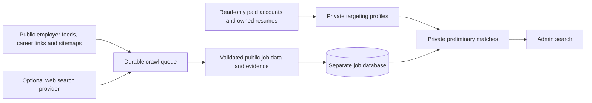

# Paid-user job index

The collector is independent of application runs. It reads active paid accounts, derives role/skill targeting from saved keywords and owned resumes, gathers public vacancies, and stores them in a **separate Neon-hosted PostgreSQL database, outside the VPS**. The crawler process can run on the VPS; the job catalog is never provisioned there. The administrator can search it under **Admin → Job index**. No job is approved, prepared, submitted or charged an application credit by this collector. Existing application schedules and fit criteria are unchanged.

## Collection and coverage

Built-in feed parsers cover Greenhouse, SmartRecruiters, PageUp and Workday, using their public job data. Existing paid-user employer selections and employer URLs are starting points. Career links and XML sitemaps expand discovery; observed ATS URLs can add new employers to the feed queue. Generic career pages use bounded JSON-LD `JobPosting` graph extraction. A page without readable public job data is not converted into a guessed vacancy.

Brave Search provides optional broader web leads; it requires a separately configured key, and this feature does not buy a subscription. Only role keywords are queried, never raw resumes, names, contact information or candidate answers. There is a durable global cap of **20 search requests per database day**. Snippets are leads only, never indexed as verified jobs. This is bounded discovery across public sources, not a claim to cover every job on the internet. Unsupported JavaScript layouts or denied sources remain coverage gaps until an adapter is added; collection does not bypass login or challenges.

## Tags and matching

Stored fields include employer, title, canonical source URL, source identity, full available description, location, applicant-location restrictions, remote/hybrid/onsite/unknown arrangement, salary disclosed/unpaid/not mentioned, structured salary range/currency/period when supplied, employment type, occupation category, seniority, skills, suitability audiences, stated qualifications/experience/eligibility requirements, posting/closing dates, first seen and last verification.

Evidence accompanies tags; inferred occupation categories are marked inferred. Missing pay is not called unpaid. A postal location alone does not prove onsite work, and remote work does not prove eligibility from any country. Private matches retain keyword/skill reasons and unresolved location/arrangement preferences. They are **potential discovery matches**, not a final job-fit assessment. If keywords are set, skills alone cannot override a keyword mismatch. Private profiles retain derived terms and fingerprints, not raw resume text. Unchanged resumes are cached; changed files/settings invalidate targeting. Deleted, blocked or expired-paid owners and their private matches are purged on the next worker check, including while collection is paused.

## Persistence and operational boundaries

Jobs deduplicate by canonical URL, stripping tracking parameters while preserving vacancy identifiers. Distinct URLs are not guessed to be identical merely from an employer/title. A per-vacancy transaction lock protects simultaneous writes; content versions preserve prior public facts. Jobs disappear from current search when closed, expired or not verified for 14 days. Confirmed HTTP 404/410 and expired structured listings close existing entries; inaccessible pages are not falsely called closed.

The queue uses leased tasks, `FOR UPDATE SKIP LOCKED`, a single-worker advisory lock, owner-scoped matching, stale-lease protection and bounded retries (three failed task attempts). Interrupted cycles remain recorded. Requests are DNS-pinned to validated public IPv4 addresses, with every redirect checked, byte/time limits, robots rules, host pacing and no account cookies. Crawl challenges are recorded as blocked. There are at most 160 HTTP reads and 40 tasks per cycle, a five-minute worker interval, ten paginated feed batches per query and a 5,000-pending-task limit. No AI calls are required for extraction/tagging.

The worker has a dedicated read-only login to the application DB and a different writable login to its own DB. It has no application or billing write grants. Resume file reads stay within the owned file directory. Pause/resume actions record the admin actor. The crawler is stopped before deployment rewrites compiled parsers, then restarted after checks and schema setup. It never shares an application browser.

## Setup and verification

Create a dedicated database/project in Neon, then set its **direct** connection string in **Admin → Config → Job discovery → Neon database connection** and the Brave key in the adjacent secret field. Values are write-only to the browser. The catalog requires verified TLS and rejects localhost/IP literal endpoints, non-Neon hosts and known transaction-pooling endpoints. Direct connections preserve the crawler's session lock. Neither a Neon subscription nor a Brave subscription is purchased by this feature.

`deploy/install-job-index.sh` provisions only a limited read-only login to the existing application database and protected `/etc/owtomate-job-index.json`; it never creates a database on the VPS. It starts the worker through the normal safe deployment. The worker waits quietly until the external connection is configured, migrates the Neon schema, and begins indexing. Root can alternatively configure a connection through `dashboard/scripts/set-job-index-connection.mts`, receiving JSON from protected stdin rather than a CLI argument. Existing role passwords are not rotated by later installs. `JOB_INDEX_CONFIG` can select a separate configuration file. `npm run job-index:once` in `dashboard` performs one bounded indexing cycle.

Targeted checks: `npm run test:job-index`; PostgreSQL integration with `tsx --test server/job-index/store.test.ts` against an isolated generated schema; `tsx scripts/test-job-index-ui.mts`; `npm run build` in `dashboard`. Tests cover tags, missing/negative facts, expiry, JSON-LD graphs, canonical dedupe, private matching, robots/challenges/redirects, paid eligibility, caching, concurrent upserts and leases, stale workers, provider caps, private-data purge, an end-to-end synthetic crawl, and responsive admin controls. They never submit applications or contact employers.

Design references: [Schema.org JobPosting](https://schema.org/JobPosting), [Greenhouse public Job Board API](https://docs.greenhouse.io/job-board), [Robots Exclusion Protocol](https://www.rfc-editor.org/rfc/rfc9309.html), [Brave Web Search API](https://api-dashboard.search.brave.com/api-reference/web/search/get).
